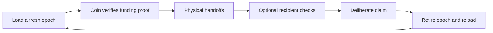

# Physical Bearer Cryptocurrency, in plain language

> **Unimplemented research RFC — valueless test networks only.**

This project asks whether a digital asset can circulate as a physical object
without putting every handoff on a blockchain. The object would look and behave
more like cash than a hardware wallet: whoever physically holds an active coin
can pass it to someone else, inspect it, or deliberately claim its represented
value.

The repository describes a target design. It does not contain working hardware,
smart contracts, an application, or evidence that the security assumptions hold.

## The five-step idea

1. **Load:** a coin reveals a fresh account and activation challenge. A loader
   funds that exact account on a valueless test network. The coin becomes active
   only after its secure core verifies finalized evidence of the funding.
2. **Carry:** the persistent display shows one represented asset and amount. The
   display is a label for signed coin state, not a live blockchain guarantee.
3. **Hand off:** people can physically pass the coin without an account, app,
   network connection, or onchain transfer.
4. **Verify:** a recipient may inspect the object, authenticate what its secure
   core reports, check current chain backing, or use several checks together.
   Each check answers a different question; none proves everything.
5. **Claim or reload:** deliberate three-button authorization moves the represented
   value to a specified destination. After finalized depletion and retirement,
   the finite core can generate the next epoch's key and begin another load cycle.

## What a recipient can learn

The design deliberately separates three kinds of information:

- `coreState`: what the secure core reports about its own lifecycle;
- `observedChainState`: what a named chain source reports or proves now; and
- `externalRiskStatus[]`: what selected policy publishers think about the
  hardware, asset, or surrounding system.

For example, “core authenticated” does not prove the core is physically inside
the shell being presented. “Funding proof accepted” does not prove the backing is
still present now. “No warning” means only that the selected feeds supplied none.
Immediate successful claim is stronger because it transfers the value instead of
predicting whether the physical object will remain trustworthy.

## The version 1 baseline

Version 1 uses **Architecture A**:

- one batteryless NFC-powered physical coin;
- a finite generate-on-advance monetary-key lifecycle;
- no command or exceptional mode that exports a monetary private key;
- one deployed immutable Ethereum smart account per active epoch;
- one represented asset and exact amount per epoch;
- optional physical handoff without network participation; and
- exact, destination-bound claim authorization.

“Non-exportable” is a requirement, not an established security property. Weak key
generation, reset-induced ECDSA nonce reuse, firmware compromise, or physical
extraction could still reveal or control the key.

## The privacy research alternative

**Architecture B** would replace each visible per-coin account with a hidden note
inside a shared commitment/nullifier pool. It may eventually reduce public
linkage, but no circuit, proof system, setup, proving boundary, or exit system has
been selected or validated. It is not part of version 1.

Architecture A is publicly linkable at funding, online checks, account reuse, and
claim. Optional BSLRR continuity records are not anonymous or unlinkable. The
project makes no production privacy claim.

See the [architecture comparison](./docs/architecture-at-a-glance.md) for the two
designs side by side.

## Why this is not ready for value

There is no implementation or independent validation. Seven Critical complaints
remain open or partially addressed. The principal blockers include:

- live relay authenticating the wrong physical object;
- incomplete canonical encoding and test vectors;
- register consent and monetary-operation serialization;
- fees consuming represented ETH;
- reset-unsafe ECDSA signing;
- unprofiled long-lived key entropy;
- permanently stranded `AUTH_PENDING` coins;
- same-chain-ID fork replay; and
- unproven passive proof verification and complete-equipment safety.

The [project status](./STATUS.md) is the authoritative maturity summary.

## Where to go next

- Read [RFC-0001](./rfcs/0001-physical-bearer-cryptocurrency/README.md) for the
  canonical version 1 draft profile.
- Use the [glossary](./GLOSSARY.md) when a protocol term is unfamiliar.
- Review the [feedback requests](./FEEDBACK.md) to see the six most useful open
  contributions.
- Consult the [master architecture](./docs/master-architecture.md) for the full
  rationale and flows.
