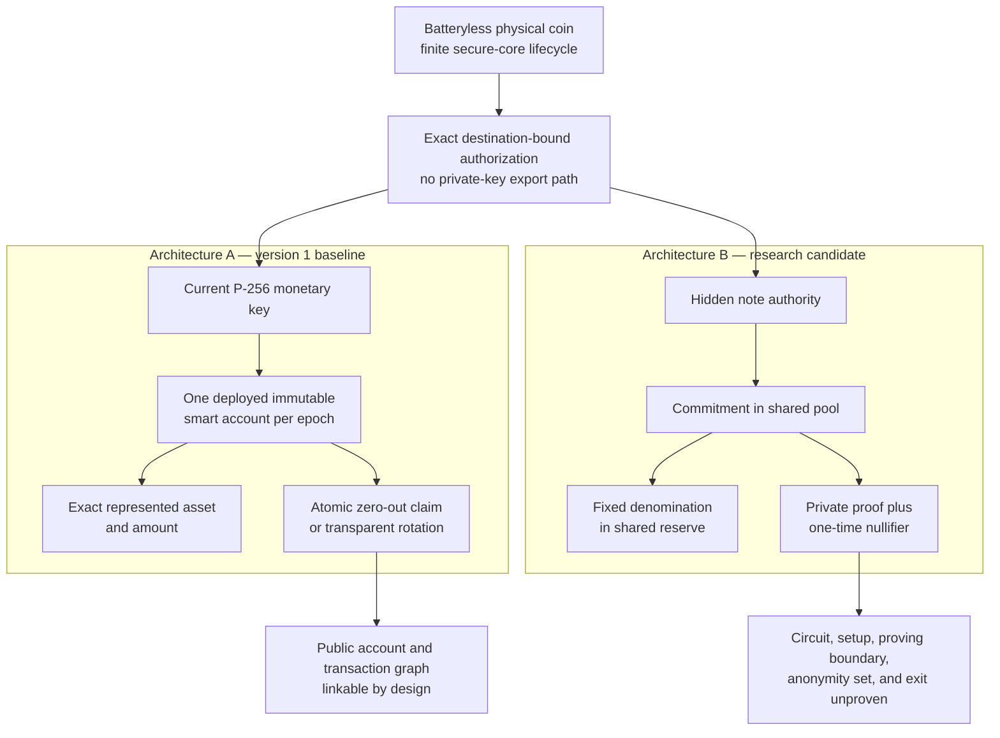

# Architecture at a glance

This diagram compares the selected version 1 baseline with the later privacy
research candidate. Both are unimplemented.

| Question | Architecture A | Architecture B |
|---|---|---|
| Status | Version 1 reference prototype target | Later research candidate |
| Backing location | Separate identifiable smart account | Shared commitment/nullifier reserve |
| Coin authority | P-256 key authorized by the account | Hardware-held authority bound to a hidden note |
| Ordinary verification | Core attestation plus optional chain observation | Proposed composite private presentation |
| Claim | Exact account transition and authority retirement | Nullifier consumption and exact pool withdrawal |
| Principal benefit | Narrower and easier to reason about | Potentially less public per-coin linkage |
| Principal cost | Public account graph is linkable | Shared-pool, circuit, proving, setup, and exit complexity |
| Current evidence | No implementation or hardware evidence | No selected construction or implementation |

Architecture B cannot replace or interoperate with Architecture A in version 1
without a later explicit superseding decision and completion of its
[evaluation gates](./architecture-b-commitment-pool.md#evaluation-gate).
